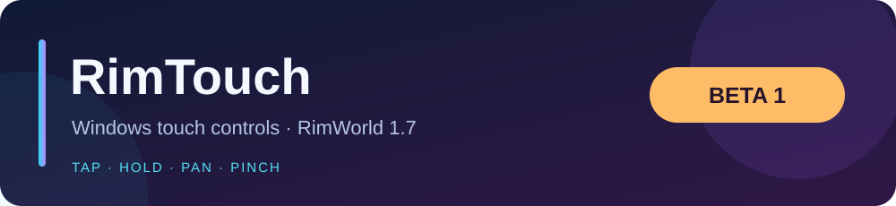

<p align="center"></p>
<p align="center">
  
  
  
  
  <a href="LICENSE"></a>
</p>

# RimTouch · 1.7 Beta

Windows touchscreen controls for RimWorld 1.7, including a remote pointer mode for Remote Desktop and Steam Link.

[**Download beta 3**](https://github.com/Cupears/RimTouch/releases/tag/v1.7.0-beta.3) · [Changelog](CHANGELOG.md) · [Bug reports](https://github.com/Cupears/RimTouch/issues/new/choose)

## 🟦 Controls

| Gesture | Action |
|---|---|
| Tap | Select or press a button |
| Double tap | Group selection or colonist-bar jump |
| Hold | Right-click menu |
| Drag | Map pan |
| Hold, then drag | Selection box |
| Two fingers | Pan and pinch zoom |
| Two-finger tap | Cancel an active map tool |
| Drag inside a scroll view | Menu scrolling |

## 🟩 Install

1. Close RimWorld.
2. Download and extract `RimTouch-1.7.0-beta.3.zip` into `RimWorld/Mods`.
3. Enable **Harmony** and **RimTouch 1.7 Beta**.
4. Disable the original RimTouch; enable only one version.
5. Open **Options → Mod settings → RimTouch**.
6. For mouse-only Remote Desktop or Steam Link, enable **Remote pointer mode**.
7. Check the input status and contact count, then test gestures on a temporary map.

Requirements: RimWorld **1.7**, Harmony for **1.7**, Windows **10/11**, and a local or remote touchscreen client.

## Remote play

| Connection | Input mode | Available input |
|---|---|---|
| Direct touchscreen | Native | Separate fingers and pinch |
| RDP with touch redirection | Native, if contacts arrive | Separate fingers and pinch |
| Mouse-only RDP or Steam Link | Remote pointer | One-finger gestures; wheel zoom |

Remote pointer mode also changes physical left-mouse dragging into touch panning. Right-click and wheel input remain available. Hold and drag require continuous pointer input from the client. Click-only forwarding cannot provide those gestures.

Separate two-finger gestures require native touch contacts. Client-side pinch-to-wheel may still provide zoom in remote pointer mode.

## 🟨 Beta notes

- Native Windows touch input; no dependency on the unfinished legacy touch API in 1.7.
- Input capture limited to the game window; physical mouse controls retained.
- UI mouse events retained for menus, sliders, text fields, and active map tools.
- Extended zoom disabled by default; previous zoom range restored when disabled.
- Load after SimpleCameraSetting if installed; test other camera and UI mods separately.
- Native and remote pointer modes available; select the matching input mode in settings.
- Linux, macOS, and RimWorld 1.6 excluded from this beta package.
- Hardware gesture checks pending; device test checklist in [Testing](docs/TESTING.md).

## 🟪 Build and checks

.NET 10 SDK required. Set local game paths:

```powershell
$env:RIMWORLD_ROOT = 'D:\SteamLibrary\steamapps\common\RimWorld'
$env:HARMONY_DLL = 'D:\SteamLibrary\steamapps\workshop\content\294100\2009463077\1.7\Assemblies\0Harmony.dll'
pwsh -File Source/build.ps1 -Test -Package
```

Checks: contact lifecycle, quick taps, movement, cancellation, display scaling, Windows data layout, and all **28 Harmony hooks** against RimWorld **1.7.4985**.

Game and Harmony binaries excluded from the download and repository.

## 🟧 Changelog · beta.3

- Added native Windows touch input and remote pointer mode for 1.7.
- Added movement deltas, quick-tap buffering, and focus-loss cancellation.
- Added scroll-view touch hook and input status display.
- Fixed 1.7 raycast overload and inspect-panel detection.
- Fixed zoom reset and isolated patch startup failures.
- Updated build tools, tests, metadata, and beta packaging.

## Credits and license

- Original project: [iLtanaka/RimTouch](https://github.com/iLtanaka/RimTouch) · Tatsuki Tanaka.
- 1.7 beta fork: [Cupears/RimTouch](https://github.com/Cupears/RimTouch).
- [GPL-3.0-or-later](LICENSE).
